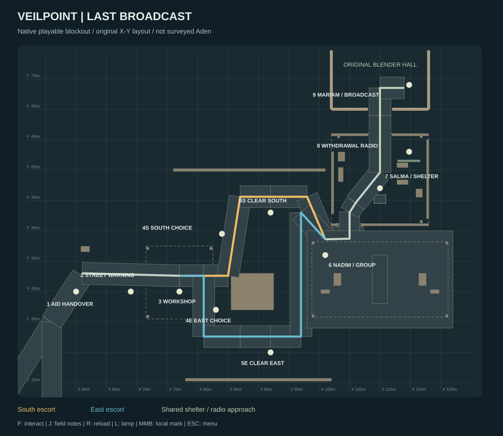

# CH01 PC 플레이 검사

실행기 `C:\VEILPOINT\START_BUILD_PC.cmd` 창은 빌드 작업을 받을 때 열어 둔다.
빌드가 끝난 게임만 실행할 때는 이 창이 필요하지 않다.

검증된 최신 게임은 다음 파일로 실행한다.

```text
C:\VEILPOINT\.tools\native-packages\PLAY_LATEST_VEILPOINT.cmd
```

빌드가 실패하면 이 파일은 이전 검증본을 계속 실행한다. 창에 표시되는
소스 커밋으로 새 버전인지 구별한다. `Windows` 폴더 속 EXE 하나만 떼어
옮기지 않는다. 로그는 실제 패키지의 `OPEN_LOGS.cmd`로 연다.



이 그림은 제작한 블록아웃의 X/Y 좌표를 그대로 그린 계획도다. 실제 아덴
실측 지도·현재 위치 추적·완성된 게임 화면을 뜻하지 않는다.

## 플레이 순서

1. 기존 구간에서 F로 중계기를 복구한다. 기록 두 개는 선택 사항이다.
2. 남쪽 또는 동쪽 경로를 택해 기존 출구까지 이동한다. 동쪽은 문이
   실제로 완전히 열려야 통과 확인이 가능하다.
3. 출구에서 이어지는 포장 길을 따라 남동쪽 구호품 인계소로 이동한다.
   Yusuf 인계 확인 → 거리 위험 확인 → 작업장 집결 순서로 F를 누른다.
4. 사람 두 명과 보급품이 작업장까지 도착한 뒤 남쪽 또는 동쪽 표지를
   선택한다. 통로 끝에서도 세 대상이 실제로 도착해야 확인할 수 있다.
   길이 막히면 먼저 비켜 준다. 다음 장소에 먼저 도착했다고 집결을
   완료한 것으로 처리하지 않는다.
5. Nadim의 정차 차량 옆에서 집결을 확인하고, 일행과 함께 걸어서
   청록색 들보가 있는 북쪽 출입구로 들어간다. 접수대 앞 청록색 바닥에서
   기다리면 호송 일행이 통로를 계속 걸을 수 있다. 화면의 주민 2명과
   보급품 1개 도착 상태를 확인한 뒤 Salma에게 F로 인계한다.
6. 대피소 옆 한국 측 철수 무전 확인 후, 남쪽 출입구를 지나 적재동 중앙 출입구로 들어가
   오른쪽 방송 책상에서 F를 누른다. 12초 메시지를 끝까지 진행한다.
   자리를 벗어나거나 시야가 막히면 중단되고, 다시 F로 시작한다.
7. J 수첩에서 경로·인계·방송 상태를 확인한다. 대피소 인계 성공과
   한국 측 귀환 미확정은 서로 다른 결과다.

## 조작과 저장

| 키 | 기능 |
|---|---|
| WASD / 마우스 | 이동 / 시점 |
| Shift / C | 달리기 / 앉기 |
| 왼쪽 클릭 | 기본 발사 |
| R | 예비탄을 사용한 장전 |
| F / J | 상호작용 / 수첩 |
| L / 가운데 클릭 | 조명 / 실제 표면에 개인 표식 |
| ESC | 재개·그래픽·수동 임무 저장·종료 |

처음에는 탄창 30발과 예비탄 18발이다. 장전은 현재 보유한 탄약을
탄창으로 옮기며 탄약을 새로 만들지 않는다. 장전 중에는 발사할 수 없다.
수량과 시간은 프로토타입 조정값이며 실제 총기 사양 인증이 아니다.

단독 스토리는 진행 이벤트를 자동 저장하며 ESC에서도 저장할 수 있다.
새 구간은 기존 중계기 임무 저장과 별도로 관리한다. 재실행 시 검증된
집결 단계는 유지하지만, 진행 중인 이동·방송은 해당 단계에서 다시
시작한다. 플레이어 위치·체력·탄약을 저장한다는 뜻은 아니다.

빌드 자동 검사는 별도 저장 슬롯으로 실행한다. 실제 키보드·마우스
플레이, 최종 그래픽·음성, 전체 캠페인과 QHD 성능 측정은 별도 확인 대상이다.
